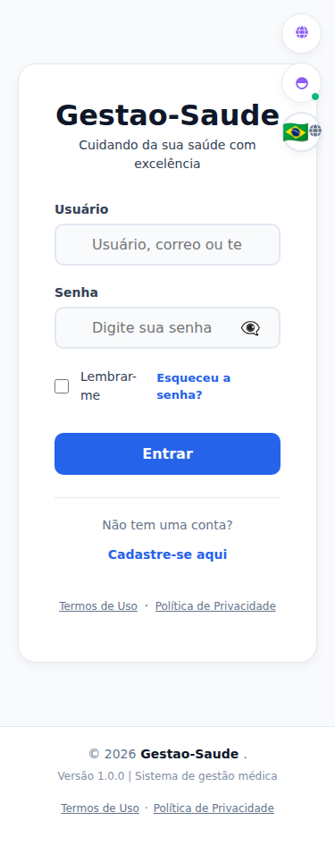
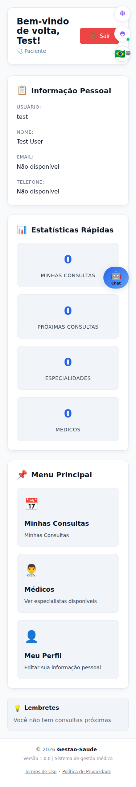
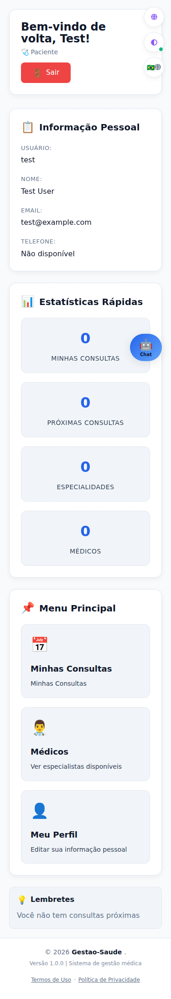
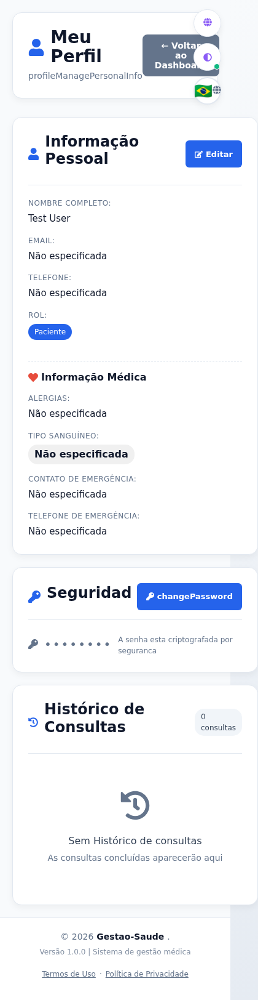

# Informe de refinamiento UI/UX

Fecha de verificación: 2026-11-11

## Alcance y contexto

Frontend de plataforma en React 19, Vite 7, React Router 7 (`BrowserRouter`), CSS global tradicional y tema gestionado por `ThemeContext` mediante `data-theme`. Pruebas con Vitest y React Testing Library. No hay un sistema de componentes visuales compartidos: formularios, botones, modales y tarjetas usan elementos HTML nativos, hojas globales y estilos inline.

Esta pasada corrige incumplimientos concretos encontrados en la revisión anterior. No modifica backend, `promo-frontend`, dependencias, rutas, autenticación, permisos, scroll restoration, persistencia de imágenes ni lógica de búsqueda.

## Inventario de rutas

Rutas declaradas en [`src/App.jsx`](./src/App.jsx). La protección y el filtrado por rol se delegan a cada página y al backend; no existe un guard común en el router.

| Ruta | Componente | Acceso observado en el router | Nota |
|---|---|---|---|
| `/` | `Bootstrap` | Redirección según sesión | `/dashboard` con sesión, `/login` sin ella |
| `/login` | `Login` | Pública | Inicio de sesión |
| `/registro` | `Registro` | Pública | Registro |
| `/forgot-password` | `ForgotPasswordPage` | Pública | Recuperación |
| `/reset-password/:token` | `ResetPasswordPage` | Pública | Restablecimiento |
| `/dashboard` | `Dashboard` | Validación en página | Panel según rol |
| `/citas` | `Citas` | Validación en página | Acciones condicionadas por rol |
| `/doctores` | `Doctores` | Validación en página/API | Directorio |
| `/perfil` | `Perfil` | Validación en página/API | Perfil de usuario |
| `/admin` | `AdminDashboard` | Validación en página | Administración |
| `/enfermeria` | `EnfermeriaDashboard` | Validación en página | Panel de enfermería |
| `/chat` | `ChatIA` | Validación en componente/API | Asistente |
| `/terminos` | `LegalPage` | Pública | Contenido legal |
| `/privacidad` | `LegalPage` | Pública | Contenido legal |
| `*` | `Navigate` | Redirección | Vuelve a `/` |

No hay subrutas declaradas en el router de plataforma.

## Inventario resumido de componentes y estilos

| Elemento | Implementación actual | Estado de centralización |
|---|---|---|
| Botones | `button` nativo, reglas globales y estilos inline | No hay componente `Button` común |
| Inputs/selects/textarea | Elementos nativos, reglas globales, estilos inline | No hay componentes comunes |
| Tarjetas y grids | Clases globales y estilos por página | Tokens disponibles, uso parcial |
| Tablas | Tablas de administración con contenedor `.table-scroll` | Sin componente común; estrategia de scroll horizontal |
| Modales | Implementación por vista | Sin diálogo común |
| Notificaciones/toasts | `NotificacionesContext` y `NotificacionesCampana` | Sin sistema común de toast |
| Tabs/badges/estados vacíos | Implementaciones por página | Sin primitives comunes |

Tokens relevantes en [`src/styles/theme.css`](./src/styles/theme.css): espaciado `4, 8, 12, 16, 24, 32, 48, 64px`; tipografía `12–36px`; radios `6, 10, 14, 20px`; transiciones `150/200ms`; foco `--focus-ring`; escala z-index `0, 1000, 1020, 1030, 1040, 1050, 1060, 1070, 1080`. La paleta existente se conserva en ambos temas. Breakpoints observados en CSS: `480px`, `481–768px`, `769px` y `767px`.

## Correcciones aplicadas

- Los inputs de formularios responsivos fijan `font-size: 16px`; campos de texto, `select` y `textarea` tienen `min-height: 44px`. Se excluyen checkbox/radio de la regla global de altura.
- Los campos de chat que estaban a `14px` ahora tienen `16px` y mínimo de `44px`.
- Los botones tienen mínimo de `44px` en viewport móvil.
- Los enlaces secundarios, legales y la etiqueta del checkbox de Login tienen área de interacción de al menos `44px`.
- Se retiraron los `outline: none` que anulaban el foco visible. Los estilos `:focus-visible` aplican un anillo de 2px; login se comprobó con teclado.
- Las alturas de viewport usan `100dvh` cuando está disponible y fallback a `100vh`. Los componentes con `minHeight` usan el token global; Chat usa altura con fallback.
- Se eliminaron los `!important` fuera de `prefers-reduced-motion`.
- Se retiraron 61 llamadas `console.log` del código fuente de la plataforma, sin reemplazarlas por otro tipo de log.
- Se añadió prueba de regresión para los tamaños de fuente de los campos de Login.

## Verificación realizada

Comprobación automatizada en Chromium de las cuatro pantallas públicas de autenticación (`/login`, `/registro`, `/forgot-password` y `/reset-password/prueba`), en tema claro y oscuro y con movimiento reducido:

| Ancho CSS | Pantallas/temas probados | Overflow horizontal | Inputs de texto | Controles/enlaces auditados |
|---:|---|---|---|---|
| 320 | 4 × 2 | No | ≥16px y ≥44px de alto/ancho | ≥44px |
| 360 | 4 × 2 | No | ≥16px y ≥44px de alto/ancho | ≥44px |
| 375 | 4 × 2 | No | ≥16px y ≥44px de alto/ancho | ≥44px |
| 390 | 4 × 2 | No | ≥16px y ≥44px de alto/ancho | ≥44px |
| 414 | 4 × 2 | No | ≥16px y ≥44px de alto/ancho | ≥44px |
| 768 | 4 × 2 | No | ≥16px y ≥44px de alto/ancho | ≥44px |
| 1024 | 4 × 2 | No | ≥16px y ≥44px de alto/ancho | ≥44px |
| 1280 | 4 × 2 | No | ≥16px y ≥44px de alto/ancho | ≥44px |

Resultado: **64 combinaciones, 0 fallos**. Se dejó que las vistas terminaran de renderizar y se emuló `prefers-reduced-motion: reduce` para medir la geometría estable, no el estado transitorio de las animaciones de entrada. La ruta de restablecimiento usa un token de prueba; esta comprobación valida presentación, no el envío al backend.

En 375px se verificó además el foco de teclado sobre un campo: `outline` visible, sólido, 2px. Los enlaces legales del footer se midieron de nuevo después de corregirlos: 44px de alto. Se capturaron screenshots de Login en `/tmp/saude-ui-verify/`; no existían capturas previas con las que comparar.

- `cd frontend && npm test`: **115 pruebas en 20 archivos pasaron**.
- `cd frontend && npm run build`: **pasó**.
- `cd frontend && npm run i18n:check`: **pasó**.
- `cd frontend && npm run lint`: **no pasa**; reporta 52 errores y 13 warnings en vistas, contextos, tests, traducciones y configuración. El lint ya fallaba antes de esta ronda. No se suprimieron reglas ni se modificaron áreas no relacionadas para ocultarlos.
- No se ejecutó una suite E2E de plataforma: `frontend/package.json` no define script Playwright/E2E.
- No se han certificado contraste AA de todas las combinaciones, pantallas autenticadas, zoom 200%, lectores de pantalla, teclado virtual ni dispositivos iOS/Android reales.

## Pendientes para poder declarar el Definition of Done

1. Completar auditoría manual en NVDA o VoiceOver, zoom 200%, teclado virtual y, si está disponible, dispositivos iOS/Android reales.
2. Validar funcionalidad de extremo a extremo (roles, acciones de tablas, agendamiento, notificaciones, perfil, scroll restoration e imágenes persistidas) contra un backend real.
3. Medir contraste AA de todas las combinaciones y estados interactivos; no se certificó de manera integral en esta pasada.
4. Corregir los 52 errores y 13 warnings de lint preexistentes.
5. Completar/verificar el deploy de Render y el hard reload: el push se realizó, pero la URL pública todavía referencia bundles anteriores.

## Verificación complementaria: selector de idioma y overflow móvil

### Selector de idioma

La causa era que cada control tenía estilos inline independientes. A 375 px el selector configuraba la bandera a 24 px, frente a los iconos de tema e inicio/promocional de 14 px; el selector tenía borde de 2 px y line-height heredado de 21 px, mientras que los otros controles usaban sus propias reglas. Aunque los contenedores medían 45 × 45 px, el contenido y algunos detalles de borde/line-height no eran iguales.

La clase común `.topbar-control` en `src/App.css` ahora establece `box-sizing`, alto/ancho, padding, borde, radio, fuente y line-height. Se aplica a los tres controles desde `src/components/LanguageToggle.jsx`, `src/components/ThemeToggle.jsx` y `src/components/PromocionalToggle.jsx`.

| Viewport | Control | Antes | Después |
|---:|---|---|---|
| 375 px | Idioma | 45 × 45 px; padding 0; borde 2 px; radio 50%; bandera 24 px + globo 14 px; line-height 21 px | 45 × 45 px; padding 0; borde 1 px; radio 50%; contenido 14 px; line-height 14 px |
| 375 px | Tema | 45 × 45 px; padding 0; borde 1.875 px; radio 50%; icono 14 px; line-height 21 px | 45 × 45 px; padding 0; borde 1 px; radio 50%; icono 14 px; line-height 14 px |
| 375 px | Inicio/promocional | 45 × 45 px; padding 0; borde 1.875 px; radio 50%; icono 14 px; line-height 21 px | 45 × 45 px; padding 0; borde 1 px; radio 50%; icono 14 px; line-height 14 px |
| 320 / 414 px | Los tres | Dimensiones de contenido no compartidas | Los tres miden 45 × 45 px y coinciden en padding, borde, radio, fuente e icono |
| 768 px | Los tres | Estilos individuales | Los tres miden 55 × 55 px, con padding 0, borde 2 px, radio 50%, icono/fuente 20 px y line-height 20 px |

Las mediciones posteriores se hicieron en contextos nuevos para cada ancho y tema. En tema claro y oscuro, los tres controles coinciden en 320, 375, 414 y 768 px. También se abrió el menú a 375 px y se seleccionó español: la bandera cambió a 🇪🇸 y la etiqueta visible a “Cambiar Idioma”.

### Causa raíz y cambios responsive

| Vista/superficie | Viewport donde se detectó | Elemento/causa raíz | Cambio aplicado | Verificación |
|---|---|---|---|---|
| Shell global | Viewports móviles | `overflow-x: hidden` en `body` y recorte en wrappers ocultaban desbordamientos reales | Retirado el recorte global de `html`/`body` y wrappers; los hijos se adaptan en sus layouts | Ancho del documento y body igual al viewport en la matriz estable |
| Mi Perfil / Historial de Citas | 320–768 px | Grid con mínimo fijo de 400 px impedía que las columnas se contrajeran; controles del encabezado no envolvían | `minmax(min(100%, 400px), 1fr)` y wrap de encabezado/acciones en `src/components/Perfil.jsx` | “Historial de Citas” visible y accesible en 320, 375, 414 y 768 px |
| Dashboard | 320–1024 px | Grids con mínimos fijos; el botón de cerrar sesión se superponía a los controles fijos de la barra superior | Mínimos de grid acotados al contenedor; encabezado flexible con wrap y espacio reservado a la barra superior en `src/components/Dashboard.jsx` | Sin intersección entre logout y controles en 320, 375, 430, 768, 1024 y 1280 px |
| Citas, Doctores y Enfermería | 320–768 px | Grids con mínimos fijos y controles de encabezado sin wrap | Mínimos de columna limitados al ancho disponible y encabezados con wrap en sus componentes | Incluidas en la matriz estable, sin overflow raíz |
| Administración y tablas | 320–768 px | Filas de tabla más anchas que el viewport; algunos títulos/botones no envolvían | Encabezados envuelven; las tablas conservan el scroll horizontal táctil local `.table-scroll` | 108 combinaciones de pestaña/ancho/tema con datos de muestra; `documentElement` y `body` no desbordan |
| Chat flotante | ≤480 px | Ancho calculado con `100vw` podía exceder el contenedor | Ancho automático con máximo y límites laterales en `src/components/ChatIA.css` | Sin overflow raíz en la matriz estable |

Las tablas de administración son intencionalmente más anchas que su contenedor local (por ejemplo, a 320 px: contenedor de 228 px y tabla de hasta 664 px), pero permanecen dentro de `.table-scroll` y se recorren horizontalmente; no amplían el documento ni el body.

### Matriz estable y evidencia visual

Se ejecutaron **364 combinaciones** de 26 pares ruta/rol, siete anchos (320, 360, 375, 390, 414, 430 y 768 px) y dos temas. En la primera pasada, 12 mediciones capturaron un estado de carga/transición a 120 ms; después de esperar a que terminaran, las 12 se repitieron y en todas `document.documentElement.scrollWidth` y `document.body.scrollWidth` coincidieron con el viewport. Resultado final estable: **0 casos con overflow horizontal raíz**. Los roles y datos fueron simulados; no se usó un backend real.

Las pestañas de administración se probaron además con filas de muestra en 108 combinaciones. El ancho del documento/body se mantuvo igual al viewport y el contenido de las tablas quedó disponible mediante su contenedor de scroll.

También se abrieron el modal de agendamiento y el modo de edición de perfil a 320, 375, 414 y 768 px: no apareció overflow raíz; los campos visibles mantuvieron fuente de 16 px y altura mínima de 44 px, y el historial siguió presente. El chat flotante se abrió a los mismos anchos; midió 300 px a 320, 355 px a 375 y un máximo de 380 px desde 414 px, siempre con márgenes laterales de 10 px y sin ampliar el documento.

Capturas comparativas a 375 px (incluyen Mi Perfil):

| Vista | Antes | Después |
|---|---|---|
| Login |  |  |
| Dashboard |  |  |
| Mi Perfil |  |  |

Las capturas se guardan en `ui-audit-screenshots/`. El baseline disponible es anterior a estas correcciones móviles; no existe una captura del refinamiento original completa para comparar.

### Restricciones y estado de aceptación

- Solo se modificó `frontend/` de la plataforma. No hubo cambios en backend, `promo-frontend` ni manifiestos de dependencias.
- No se modificó `meta viewport`; no se usa `overflow-x: hidden` en `html`/`body`.
- Los controles de las tablas usan scroll local; no se ocultan por el viewport.
- Tests (115), build e `i18n:check` pasan. Lint sigue fallando con 52 errores y 13 warnings ya existentes.
- Las verificaciones de navegador se hicieron con emulación Chromium a zoom 100%, con movimiento reducido y respuestas API simuladas. No sustituyen pruebas en dispositivo físico, zoom 200%, lectores de pantalla ni backend real.
- Commits de implementación en `Gestion-Saude`: `b37cee0` (topbar), `a359d65` (overflow responsive) y `06b00ec` (controles de autenticación/accesibilidad). Quedaban además 8 commits locales anteriores sin push; se conservaron sin reescritura.
- Se hizo push de los 12 commits de trabajo a `Gestion-Saude`; la referencia remota se verificó en `e0f455f` antes de esta actualización del informe. No se generó ningún run de GitHub Actions para esa rama.
- Se comprobó la URL pública con una consulta cache-busted: responde HTTP 200, pero sigue sirviendo `index-Dymh3Qv_.js` y `Dashboard-9a5U-yDN.js`, mientras el build local verificado referencia `index-zqfsB0Cb.js` y `Dashboard-DhCdnrJf.js`. El deploy de Render y el hard reload no están confirmados; `render.yaml` no declara la rama/autodeploy del servicio.
